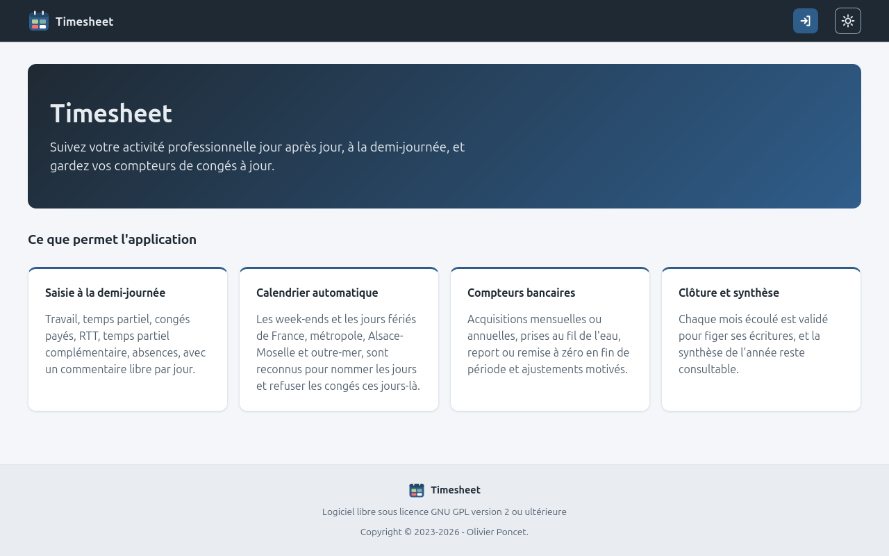

# TIMESHEET

## ABSTRACT

Timesheet is a web application for employees working in France. It tracks a professional activity half-day by half-day. It keeps the leave counters of French labour practice (paid leave, RTT, complementary part-time days…) like bank accounts, with a monthly closing and a yearly summary.

This README is the entry point: what the application does, how to try it from the sources, and where each detail is documented.



## CONTENTS

- [ABSTRACT](#abstract)
- [CONTENTS](#contents)
- [DESCRIPTION](#description)
- [REQUIREMENTS](#requirements)
- [GETTING STARTED](#getting-started)
- [BUILD](#build)
- [RUN](#run)
- [LICENCE](#licence)
- [CREDITS](#credits)

## DESCRIPTION

### Features

- Designed for the French labour market:
  - the eleven national legal holidays of metropolitan France (the two extra holidays of Alsace-Moselle are not included);
  - paid leave (congés payés), accrued at 2.08 days a month over a June-to-May period and rounded up at its end;
  - RTT days, the weekly day off and the complementary days of a part-time contract;
  - an interface in French.
- The activity codes and the counters are configurable. The holiday calendar and the rules are French: the application is not meant, as it stands, for another country.
- The rules are choices of the application, simpler than common French practice: see [Simplifications](doc/SPECIFICATIONS.md#simplifications).
- One static binary, no external service: it runs on a workstation or a small server.
- The interface is in French. The French labels quoted in this document (« Tableau de bord », « Activité »…) are the ones shown on screen. Code and documentation are in English.
- Free software, released under the GNU General Public License version 2 or later.

### Where to start

| You want to | Read |
| --- | --- |
| Understand what the application does | [Concepts](doc/USER-GUIDE.md#concepts), [Pages](doc/USER-GUIDE.md#pages) and [Accounts](doc/USER-GUIDE.md#accounts) |
| Try it on your workstation | [Requirements](#requirements), then [Getting started](#getting-started) |
| Use it day after day | [User guide](doc/USER-GUIDE.md) |
| Bring an existing history in | [Importing](doc/OPERATIONS.md#importing) |
| Build it, run the tests, build the package | [doc/BUILD.md](doc/BUILD.md) |
| Install it as a service | [Debian package](doc/OPERATIONS.md#debian-package) |
| Change the address, the host names, the time zone, the sessions or the limits | [Server configuration](doc/OPERATIONS.md#server-configuration) |
| Put it behind a reverse proxy | [Network and security](doc/OPERATIONS.md#network-and-security) |
| Upgrade an installation | [Upgrade](doc/OPERATIONS.md#upgrade) |
| Fix a refusal or an error message | [Troubleshooting](doc/OPERATIONS.md#troubleshooting) |
| Change the code | [doc/BUILD.md](doc/BUILD.md) and [Documentation](#documentation) |

### Repository layout

- One static Go binary, standard library only.
- Hand-written HTML, CSS and JavaScript. The pages work without JavaScript.
- The activity codes, the counters, the accounts and the data live in one JSON file, the database, rewritten atomically at each change.
- The server configuration (address, origins, database path, timeouts, sessions, login throttle, limits) is a second JSON file.
- The open sessions are saved in a third file, next to the database.

```text
.ci/    scripts run by the Makefile targets and by the continuous integration
bin/    timesheet (built), timesheet.sh (runs the server on the configuration and the database of the repository)
debian/ Debian packaging (package, systemd unit, post-installation script)
doc/    ARCHITECTURE.md  BUILD.md  CODING.md  OPERATIONS.md  SECURITY.md  SPECIFICATIONS.md  USER-GUIDE.md  timesheet.png
etc/    timesheet/timesheet.json (the server configuration, installed as is by the package)
share/  timesheet/ (configuration template read by init, import template)
src/    Go sources
var/    lib/timesheet/ (database of the repository, given with --database, its lock and its session file)
```

### Documentation

| Document | Content |
| --- | --- |
| [doc/USER-GUIDE.md](doc/USER-GUIDE.md) | Concepts, activity codes, pages and profiles; the tasks of the employee and of the administrator; the labels shown on screen. |
| [doc/BUILD.md](doc/BUILD.md) | Requirements, `make` targets, installation of the files, Debian package. |
| [doc/OPERATIONS.md](doc/OPERATIONS.md) | Commands, server configuration, network, logs, import, Debian package, backup, recovery, upgrade, troubleshooting. |
| [doc/SPECIFICATIONS.md](doc/SPECIFICATIONS.md) | The functional reference: glossary, profiles, entries, counters and bookkeeping, pages, routes, database schema, server configuration, command line, import format, logs, limits, personal data, simplifications, migration notes. |
| [doc/ARCHITECTURE.md](doc/ARCHITECTURE.md) | Packages, entities, HTTP chain, concurrency, persistence, lifecycle. Start with [Packages](doc/ARCHITECTURE.md#packages). |
| [doc/SECURITY.md](doc/SECURITY.md) | Threat model, sessions, passwords, login throttling, transport, data protection, accepted risks. |
| [doc/CODING.md](doc/CODING.md) | The rules of the code: dependencies, file layout, templates, styles, tests, Makefile, packaging, commits. Before a commit, see [Checks before a commit](doc/CODING.md#checks-before-a-commit). |

## REQUIREMENTS

| To | You need |
| --- | --- |
| Run | A Unix system (Linux, BSD, macOS) for the database file lock, and its time zone database (`tzdata`). |
| Build | Go 1.24 or later, and `make`; `gcc` to run the tests. The tools of the Debian package are listed in [doc/BUILD.md](doc/BUILD.md#requirements). |

The password prompt without echo needs Linux. Elsewhere, `user add` and `user passwd` read one visible line of the standard input: prefer the variable `TIMESHEET_PASSWORD` or a pipe.

## GETTING STARTED

This section goes from the sources to a running server on your workstation. To install the Debian package instead, see [Debian package](doc/OPERATIONS.md#debian-package).

- Run every command from the root of the repository.
- `<login>` is the login you choose: 2 to 32 characters among lower-case letters, digits, dots, dashes and underscores, starting with a letter or a digit.

### First start

1. Get the sources, by a clone of the repository or an archive, and enter their directory.

2. Build the binary:

   ```sh
   make
   ```

   The first build takes a few seconds more, the time to fill the Go cache `.cache/`. It ends with `=== build ok ===` and produces `bin/timesheet`.

3. Protect the directory of the database, shipped as `var/lib/timesheet/`:

   ```sh
   chmod 700 var/lib/timesheet
   ```

   - The directory must belong to the user who runs the commands and the server.
   - Without the `chmod`, a directory writable by its group gives a warning (`directory is writable by its group`).
   - A directory writable by others, without the sticky bit, is refused.

4. Create the database:

   ```sh
   bin/timesheet init --database=var/lib/timesheet/timesheet-database.json
   ```

   It answers:

   ```text
   Base créée : …/var/lib/timesheet/timesheet-database.json
   Créez maintenant un administrateur : timesheet user add <login> --profile=ADMIN --database=…/var/lib/timesheet/timesheet-database.json
   ```

   - The command it prints is the next step; from the repository root, prefix it with `bin/`. The database starts with the activity codes and counters of the configuration template and no account.
   - `--database` is needed from the sources: the server configuration of the repository names the database of the Debian package, `/var/lib/timesheet/timesheet-database.json` ([Server configuration](doc/OPERATIONS.md#server-configuration)).

5. Create your account, as an administrator:

   ```sh
   bin/timesheet user add <login> --profile=ADMIN --database=var/lib/timesheet/timesheet-database.json
   ```

   - On a Linux terminal, the password is asked twice, without echo.
   - It has at least 12 characters, 6 of them distinct, no space at its start or end, no control character, 256 bytes at most, and differs from the login.
   - To script it, give the password in the variable `TIMESHEET_PASSWORD`.
   - It answers « Compte \<login> créé (ADMIN). ».

6. Start the server:

   ```sh
   bin/timesheet.sh
   ```

   The script runs `bin/timesheet run` with the server configuration and the database of the repository, from any directory.

   - It stays in the foreground and logs on the standard error: one line per request and one per event, such as a login or a saved month. See [Logs](doc/OPERATIONS.md#logs).
   - The warning `serving plain HTTP` is expected on a workstation. Read [Network and security](doc/OPERATIONS.md#network-and-security) before exposing the server on a network.
   - Ctrl-C or SIGTERM stops it after the requests in progress (`server.shutdown_timeout`, 10 s by default).

7. Open `http://127.0.0.1:8080` or `http://localhost:8080`, choose « Se connecter » and log in. You arrive on « Tableau de bord ».

Then follow the [User guide](doc/USER-GUIDE.md).

### Next starts

- Run `bin/timesheet.sh` from any directory, or `bin/timesheet run --database=var/lib/timesheet/timesheet-database.json` from the repository root.
- The sessions survive a restart.

## BUILD

`make` builds `bin/timesheet` and `make check` runs the tests. The other targets, the requirements and the Debian package are described in [doc/BUILD.md](doc/BUILD.md).

## RUN

- From the repository: `bin/timesheet.sh` from any directory, or `bin/timesheet run --database=var/lib/timesheet/timesheet-database.json` from the root (see [Getting started](#getting-started)).
- As a service: build the Debian package, install it, then create the first administrator (see [Debian package](doc/OPERATIONS.md#debian-package)).

Everything else about running the server is in [doc/OPERATIONS.md](doc/OPERATIONS.md): server configuration, network and reverse proxy, logs, import, backup and restore, recovery, upgrade and troubleshooting.

## LICENCE

Timesheet is free software, released under the GNU General Public License version 2 or later. See [COPYING](COPYING).

```text
timesheet - Copyright (c) 2023-2026 - Olivier Poncet

This program is free software: you can redistribute it and/or modify
it under the terms of the GNU General Public License as published by
the Free Software Foundation, either version 2 of the License, or
(at your option) any later version.

This program is distributed in the hope that it will be useful,
but WITHOUT ANY WARRANTY; without even the implied warranty of
MERCHANTABILITY or FITNESS FOR A PARTICULAR PURPOSE.  See the
GNU General Public License for more details.

You should have received a copy of the GNU General Public License
along with this program.  If not, see <http://www.gnu.org/licenses/>.
```

## CREDITS

Olivier Poncet, see [AUTHORS](AUTHORS).
